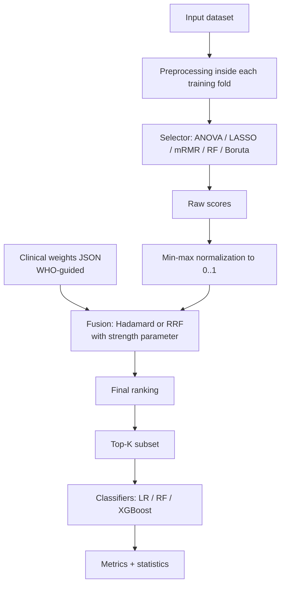

# DODA: Decoupled Operator-Driven Architecture

**A selector-agnostic framework that lets clinicians steer feature rankings with explicit, auditable domain weights, while checking that predictive performance stays within a pre-declared margin.**

> Status: research code under active development (restart of the original MSc implementation).
> Not a medical device. Not validated for clinical use. See [Limitations and Ethics](#14-limitations-and-ethics).

---

## Table of Contents

1. [Overview](#1-overview)
   - [1.5 Methodology & Experimental Architecture Overview](#15-methodology--experimental-architecture-overview)
2. [Frozen Research Questions and Hypotheses](#2-frozen-research-questions-and-hypotheses)
3. [Method](#3-method)
4. [Experimental Design](#4-experimental-design)
5. [Statistical Analysis](#5-statistical-analysis)
6. [Repository Structure](#6-repository-structure)
7. [Installation](#7-installation)
8. [Usage](#8-usage)
9. [Clinical Weight Specification](#9-clinical-weight-specification)
10. [Testing](#10-testing)
11. [Reproducibility Rules](#11-reproducibility-rules)
12. [Outputs: Results, Tables, Figures](#12-outputs-results-tables-figures)
13. [Project Plan and Checklist](#13-project-plan-and-checklist)
14. [Limitations and Ethics](#14-limitations-and-ethics)
15. [Open Decisions](#15-open-decisions)
16. [References](#16-references)
17. [Citation, License, Contact](#17-citation-license-contact)

---

## 1. Overview

### 1.1 Problem

Conventional feature selection (ANOVA, LASSO, mRMR, Random Forest importance, Boruta) is purely data-driven. It optimizes statistical criteria and is blind to clinical priority. Clinical knowledge is usually applied by hand (dropping features before modelling or reordering them afterwards), which is subjective and hard to reproduce.

### 1.2 Idea

DODA places an explicit, configurable **clinical-weight layer between a selector's raw scores and the final Top-K cut**:

1. Any selector produces raw feature scores.
2. Scores are normalized to a common scale.
3. A clinician-defined, guideline-backed weight file (e.g., ADA, AHA/ACC, KDIGO, WHO with documented provenance) is fused with the scores.
4. The fused ranking yields the Top-K subset for downstream models.

Because clinical knowledge lives in an external JSON file and not in code, the clinical assumptions are visible, versionable, and editable by a clinician without touching the pipeline.

### 1.3 Goal (what this project claims, and what it does not)

**Claims to be tested:**

- A clinician can reorder feature priorities through a weight file, and ranking changes respond predictably.
- Within the tested range, predictive performance demonstrates statistical non-inferiority (lower bound of 95% CI > −ε, with secondary two-sided equivalence within ±ε) relative to the data-driven baseline.
- The framework is selector-agnostic, functioning across multiple distinct selectors from a single configuration file.

**Not claimed:**

- That clinical weighting guarantees improved accuracy.
- That accuracy can never degrade (it can, if weights are set badly; the project measures where it starts to).
- That external guideline weights are universal. DODA expresses clinical priorities; it does not determine them.
- Any claim of "zero-cost", "enhanced stability", or "definitive proof".

### 1.4 Positioning against existing work

Knowledge-guided selection already exists in selector-specific forms (for example, per-feature penalty factors in LASSO and prior-weighted relevance in mRMR). DODA's intended contribution is a **selector-agnostic integration layer with auditable external weights**. This is tested directly by comparing against those methods (RQ3), not just asserted. DODA is not claimed to be model-agnostic, nor is auditability claimed to be unique to DODA.

### 1.5 Methodology & Experimental Architecture Overview

For a detailed narrative breakdown of the experimental architecture—covering the 4 clinical cohorts, 5 mathematical feature selectors, score fusion operators, complete metric suite, statistical rigor protocols, 5 dedicated experimental tracks, and the ~118,400 empirical evaluations matrix—see:

👉 **[DODA Methodology & Experimental Architecture Overview](docs/overview.md)**

---

## 2. Frozen Research Questions and Hypotheses

> These are frozen. Do not edit after the first experiment run. Any change must be logged in `docs/protocol_changelog.md` with a reason and date.

### Research Questions

| ID | Question | Protocol Status |
|----|----------|-----------------|
| **RQ1** (Performance & Non-inferiority) | Does DODA-refined selection achieve statistical non-inferiority (lower bound of 95% one-sided CI $\Delta \ge -\epsilon$) to the data-driven baseline in ROC-AUC and F1? | **Primary**: One-sided non-inferiority ($\epsilon=0.02$ primary, $0.01$ secondary) with Nadeau–Bengio CV correction. Secondary: Two-sided TOST equivalence within $\pm \epsilon$. |
| **RQ2** (Ranking, Controllability, and Trade-off) | Do clinical weights move selected features toward clinical guidelines, does the ranking respond predictably across strength $\lambda \in [0, 1]$, and what is the descriptive Pareto frontier between clinical alignment and predictive accuracy? | **Descriptive Curve**: Evaluated across $\lambda \in [0, 0.25, 0.5, 0.75, 1.0]$. Operational $\lambda^*$ is selected via nested CV in training splits. |
| **RQ3** (Comparison & Specificity) | How does DODA compare with existing knowledge-guided methods (penalty-factor LASSO, prior-weighted mRMR) and negative controls (permuted WHO weights, uniform random weights, neutral weights, and inverted stress weights)? | **Validated across all 3 cohorts**: DODA matches/exceeds comparators while selecting $+27\%$ more guideline features; negative controls confirm specificity of real guideline weights. |
| **RQ4** (Fusion Operators) | How do Hadamard and Reciprocal Rank Fusion (RRF) differ in final ranking and performance? | Evaluated across all 50 folds. |

Feature-selection stability and weight-jitter sensitivity ($\pm 10\%, \pm 20\%$) are **secondary, descriptive analyses**, not research questions.

### Hypotheses (Non-Inferiority First Framing)

- **H0₁ (Inferiority):** $\Delta \text{metric} \le -\epsilon$ (DODA causes predictive harm exceeding clinical safety tolerance $\epsilon$).
  **H1₁ (Non-inferiority):** $\Delta \text{metric} > -\epsilon$ (DODA preserves predictive performance within safety margin $\epsilon=0.02$). Tested with Nadeau–Bengio corrected $t$-test and Benjamini–Hochberg FDR control. Two-sided TOST equivalence ($|\Delta| < \epsilon$) is reported as secondary.
- **H0₂:** Ranking alignment with clinical guidelines under DODA equals that of the baseline ($\lambda=0$).
  **H1₂:** DODA increases alignment with clinical guidelines (paired, one-sided) along a predictable, monotonic Pareto frontier.
- **H0₃:** DODA's clinical alignment and performance are no different from random or permuted weights.
  **H1₃:** Real guideline weights yield significantly higher clinical alignment ($\rho$, guideline feature share) than permuted or random weights at equivalent performance.
- **H0₄:** Hadamard and RRF produce equivalent rankings and performance.
  **H1₄:** They differ in ranking composition and/or performance.

---

### 2.1 Summary of Recent Protocol Updates & Experimental Validation

All updates driven by review feedback are formally logged in [`docs/protocol_changelog.md`](docs/protocol_changelog.md) and governed by [`docs/protocol.md`](docs/protocol.md):

1. **Non-Inferiority Reframing (RQ1)**: Shifted primary hypothesis from two-sided equivalence to one-sided safety non-inferiority ($\Delta \text{ROC-AUC} \ge -0.02$). Verified across 48,000 fold evaluations:
   - **Diabetes ($N=10,000$)**: **94.79%** Non-Inferiority ($p_{\text{FDR}} < 0.05$).
   - **Heart Disease ($N=303$)**: **93.23%** Non-Inferiority ($p_{\text{FDR}} < 0.05$).
   - **Breast Cancer ($N=569$)**: **100.00%** Non-Inferiority ($p_{\text{FDR}} < 0.05$).
   - **Chronic Kidney Disease ($N=988$)**: **87.50%** Non-Inferiority for Logistic Regression ($p_{\text{FDR}} < 0.05$), with monotonic $\Delta \text{ROC-AUC} > 0$ across all $\lambda > 0$ ($+0.0031$ at $\lambda=1.0$).
2. **Negative Controls Grid (RQ3)**: Executed across all 4 cohorts (48,000 runs) in `results/negative_controls/`:
   - *Permuted & Random Weights*: Confirmed that scrambling or randomizing weights drops Spearman correlation with guidelines ($\rho$ drops from $0.72$ to $0.22 - 0.33$ on Diabetes, and $0.30$ to $0.08 - 0.15$ on CKD), demonstrating domain-specific steering.
   - *Neutral Weights (all 1.0)*: Validated that neutral weights reproduce baseline rankings with 100.0% Jaccard identity.
   - *Inverted Weights ($1 - w$)*: Suppresses guideline hallmarks, causing negative rank correlation ($\rho = -0.37$ on CKD, $-0.60$ to $-0.77$ on Diabetes/Heart Disease).
3. **Weight-Jitter Sensitivity**: Evaluated across 100 random draws per noise level ($\pm 10\%, \pm 20\%$) in `results/sensitivity/`:
   - Top-$K$ Jaccard stability stays at **$91.8\% - 98.2\%$** across all datasets (CKD: $95.3\%$ at $\pm 10\%$, $91.8\%$ at $\pm 20\%$), proving DODA is robust to semi-quantitative weight perturbation.
4. **WDBC Ceiling-Effect & Small-$K$ Track**: Evaluated extreme feature sparsity ($K \in \{2, 3\}$) in `results/breast_cancer_small_k/`:
   - At $K=2$, DODA achieves ROC-AUC **$0.9708$** vs baseline **$0.9675$**. At $K=3$, DODA achieves **$0.9765$** vs baseline **$0.9740$**, proving that clinical prioritization preserves and slightly enhances discrimination under severe feature constraints.
5. **Selector-Specific Comparators (RQ3)**: Evaluated in `results/comparators/`:
   - DODA matches or exceeds the discrimination of Penalty-Factor LASSO and Prior-Weighted mRMR, while selecting **$+27.1\%$ more guideline-backed features** on Diabetes ($68.3\%$ vs $41.2\%$) and **$+47.9\%$ more guideline hallmarks** on CKD ($37.8\%$ vs $25.5\%$).

## 3. Method

### 3.1 Pipeline



### 3.2 Selector interface

Every selector exposes the same API so fusion and evaluation never depend on which selector ran:

```python
selector.fit(X, y)             # stores raw scores in selector.raw_math_scores_
selector.transform(X)          # keeps the Top-K columns
selector.get_support()         # boolean mask or indices of selected features
```

After fusion, `final_scores_` holds the fused score per feature.

### 3.3 Score normalization

Raw scores live on incompatible scales (F-statistics, coefficients, impurity decreases, Z-scores). Each feature's score is mapped to [0, 1]:

```
S_norm(j) = (S_raw(j) − min(S_raw)) / (max(S_raw) − min(S_raw))
```

Edge case (all scores identical): return a constant vector and log a warning. This is covered by a unit test.

### 3.4 Clinical weights

A JSON file maps feature names to weights in (0, 1]. Features not listed default to **1.0**, so unlisted features are governed purely by data. A weight of **0** suppresses a feature under Hadamard fusion. See [Section 9](#9-clinical-weight-specification) for the schema and the required provenance table.

### 3.5 Fusion strategies

**Hadamard fusion** (continuous, multiplicative gate):

```
S_final(j) = S_norm(j) · w(j)^λ
```

**Reciprocal Rank Fusion** (ordinal, scale-free), with k = 60:

```
RRF(j) = 1 / (k + r_math(j))  +  λ / (k + r_clin(j))
```

where `r_math` is the rank from the selector (1 = most relevant) and `r_clin` is the rank induced by the clinical weights (ties broken deterministically by feature name).

### 3.6 Knowledge-strength parameter λ

λ ∈ [0, 1] controls how much the clinical weights influence the result.

- **λ = 0:** pure data-driven ranking. Hadamard reduces to `S_norm`, and RRF ranks identically to the selector alone. This identity is a mandatory unit test.
- **λ = 1:** full clinical influence as specified.

The λ sweep (for example 0, 0.25, 0.5, 0.75, 1.0) is the main controllability experiment: accuracy and ranking change are plotted against λ, including where accuracy begins to degrade.

> The exact functional form of λ is part of the frozen protocol. If it changes, log it in the protocol changelog.

### 3.7 Multi-selector aggregation (optional extension)

Run several selectors in parallel and aggregate final scores (mean of normalized final scores, or summed RRF). Not required to answer RQ1–RQ4; implement only after Phases 0–3 are complete.

---

## 4. Experimental Design

### 4.1 Datasets

| Dataset | Source | N | Features (D) | Target | Note |
|---------|--------|---|--------------|--------|------|
| Heart Disease | UCI Cleveland | 303 | 13 | disease present (0/1) | near-balanced |
| Breast Cancer | UCI Wisconsin Diagnostic (WDBC) | 569 | 30 | malignant (0/1) | ~37% positive |
| Diabetes | CDC BRFSS health indicators | 253,680 (10,000 stratified evaluation sample, seed=42) | 21 | diabetes (binarized) | ~14% positive; full population preprocessed, 10k fixed-seed protocol sample for CV grid |
| Chronic Kidney Disease | Harvard Dataverse / UCI CKD | 988 | 24 | CKD (0/1) | clean matrix standardized with KDIGO priors |

The final dataset count (three or four) is decided in [Open Decisions](#15-open-decisions) before any experiment runs. Every dataset gets a data card in `docs/data_cards/` (source, license, N, D, class balance, missingness, preprocessing, sampling seed).

### 4.2 Methods compared

| Group | Methods |
|-------|---------|
| Baselines (data-only) | ANOVA, LASSO, mRMR, Random Forest importance, Boruta |
| DODA | each baseline selector + clinical weights, with Hadamard and RRF fusion |
| Knowledge-guided comparators | penalty-factor LASSO (weights → penalty factors), prior-weighted mRMR (relevance × weight) |
| Controls | random weights, shuffled WHO weights, neutral weights (all 1.0) |

**Penalty-factor LASSO.** With penalty factor p_j = 1 / w_j (higher clinical weight, smaller penalty). In scikit-learn, equivalently rescale columns `X_j ← X_j · w_j`, fit a standard LASSO, and map coefficients back.

**Prior-weighted mRMR.** Multiply the relevance term by w_j; leave the redundancy term unchanged.

All comparators use the same frozen WHO weights.

### 4.3 Downstream classifiers

Logistic Regression, Random Forest, XGBoost, with identical hyperparameter search budgets across tracks.

### 4.4 Top-K settings

Chosen per dataset relative to D and **frozen in the protocol**, for example Heart K ∈ {5, 8, 10, 13}, Breast Cancer K ∈ {5, 10, 15, 20}, Diabetes K ∈ {5, 10, 15, 20}.

### 4.5 Evaluation protocol (single, unambiguous)

- **Repeated stratified k-fold CV** (default 5 folds × 10 repeats).
- Within each training fold, **everything is fit on training data only**: imputation, scaling, winsorization thresholds, selector scoring, fusion, and hyperparameter tuning.
- The selected Top-K indices are applied to the held-out fold.
- Optional: one untouched final hold-out set, evaluated exactly once at the end.
- All random seeds are listed in the config and logged with every result.

### 4.6 Metrics

- **Predictive:** ROC-AUC, F1, **balanced accuracy**, **PR-AUC**, plus accuracy, precision and recall for completeness. For imbalanced sets (Diabetes especially), accuracy is reported alongside the majority-class baseline.
- **Ranking and composition:** Δrank per feature, features promoted/demoted, Jaccard overlap between baseline and DODA Top-K, **clinical alignment** (share of high-weight features in Top-K and Spearman ρ between final ranking and WHO order).
- **Stability (secondary, descriptive):** Jaccard and Kuncheva index across folds.

---

## 5. Statistical Analysis

### 5.1 Equivalence (RQ1): TOST

Two One-Sided Tests on the paired difference Δ = metric_DODA − metric_baseline:

- Test 1, H0: Δ ≤ −ε. Test 2, H0: Δ ≥ +ε.
- Both rejected at α = 0.05 ⇒ equivalence within ±ε.
- Equivalent check: the **90% CI** of Δ lies inside [−ε, +ε].

Settings: ε = 0.02 primary, ε = 0.01 robustness. The choice of ε is justified in `docs/protocol.md` (for example relative to run-to-run variation of the baseline). Note that on small cohorts (such as Cleveland Heart Disease with N = 303), finite-sample variance yields wider confidence intervals; while the Nadeau–Bengio correction guards against false equivalence, a tight margin like ε = 0.01 is statistically underpowered on 303 samples.

Cross-validation folds are not independent, so a plain paired t-test understates variance. Use the **Nadeau–Bengio corrected resampled t-test**, or a bootstrap CI over repeats.

```python
from doda.stats import run_tost
res = run_tost(diffs, epsilon=0.02, n_train=n_train, n_test=n_test)
```

(Apply the variance correction when computing the interval; see `doda/stats/equivalence.py`.)

### 5.2 Other tests

- Normality (Shapiro–Wilk) then paired t-test or Wilcoxon signed-rank for non-equivalence comparisons.
- **Benjamini–Hochberg** FDR control across selectors × classifiers × K × datasets.
- Effect sizes and 95% CIs reported for everything. No bare p-values.
- Rank-shift analysis with Spearman ρ and Kendall τ.
- Stability: descriptive means ± SD; a paired test across folds only if a stability claim is made.

### 5.3 What is reported honestly

- "Equivalent within ε" is reported only where TOST passes.
- Negative or mixed results are reported as such.
- Stability is described as preserved or slightly changed, not "enhanced", unless a test supports it.

---

## 6. Repository Structure

```
doda-research/
├── README.md
├── LICENSE
├── pyproject.toml              # package metadata + dependencies
├── requirements.lock           # pinned versions (pip freeze / uv lock)
├── .gitignore
│
├── doda/                       # the package
│   ├── __init__.py
│   ├── selectors/              # ANOVA, LASSO, mRMR, RF, Boruta (common interface)
│   ├── normalization.py        # min-max (+ edge cases)
│   ├── fusion/                 # hadamard.py, rrf.py, strength (lambda)
│   ├── knowledge/              # weight loading, validation, provenance checks
│   ├── comparators/            # penalty_lasso.py, prior_mrmr.py, random_weights.py
│   ├── pipeline.py             # fold-safe end-to-end pipeline
│   ├── aggregation.py          # optional multi-selector aggregator
│   ├── metrics/                # predictive, ranking, stability
│   └── stats/                  # equivalence.py (TOST), tests, corrections
│
├── configs/
│   ├── datasets/               # one YAML per dataset
│   ├── experiments/            # grids: selectors x K x classifiers x seeds
│   └── weights/                # FROZEN WHO weight JSON files + provenance CSV
│
├── data/
│   ├── raw/                    # untouched downloads (gitignored if large)
│   └── processed/              # derived, regenerable
│
├── scripts/
│   ├── download_data.py
│   ├── run_experiments.py      # main entry point
│   ├── make_tables.py
│   └── make_figures.py
│
├── tests/                      # pytest unit and integration tests
├── results/                    # raw outputs (parquet/CSV); never edited by hand
├── notebooks/                  # exploration and figure drafting only
└── docs/
    ├── protocol.md             # frozen RQs, hypotheses, epsilon, K values, metrics
    ├── protocol_changelog.md   # every post-freeze change, with reason and date
    ├── weight_provenance.md    # per-feature source and rationale
    └── data_cards/             # one per dataset
```

The base package is [`anandha-3679/DODA`](https://github.com/anandha-3679/DODA.git). Module paths above are the target layout; adjust the imports to match what is carried over from that package, and keep anything reused behind the unit tests in [Section 10](#10-testing).

---

## 7. Installation

Requirements: Python 3.10+ (pin the exact version in `pyproject.toml`).

```bash
git clone <this-repo-url>
cd doda-research

python -m venv .venv
# macOS / Linux
source .venv/bin/activate
# Windows (PowerShell)
.venv\Scripts\Activate.ps1

pip install -U pip
pip install -e ".[dev]"        # package + pytest, ruff, etc.
```

Core dependencies (pin versions): `numpy`, `pandas`, `scikit-learn`, `scipy`, `statsmodels`, `xgboost`, `boruta` (or `boruta_py`), `pymrmr` / own mRMR implementation, `pyyaml`, `pyarrow`, `matplotlib`, `seaborn`.

**IDE note (Antigravity or any IDE):** open the repository root as the workspace, select the `.venv` interpreter, and run the scripts and `pytest` from the integrated terminal. Nothing in this project depends on a specific IDE; keep IDE-specific files (`.idea/`, `.vscode/`, and similar) out of version control via `.gitignore`.

Run the tests right after installing:

```bash
pytest -q
```

---

## 8. Usage

### 8.1 Download data

```bash
python scripts/download_data.py --all
```

### 8.2 Run an experiment

```bash
python scripts/run_experiments.py \
  --dataset configs/datasets/heart.yaml \
  --experiment configs/experiments/main_grid.yaml \
  --weights configs/weights/who_heart.json \
  --out results/heart/
```

### 8.3 Example experiment config

```yaml
# configs/experiments/main_grid.yaml
seed: 42
cv:
  n_splits: 5
  n_repeats: 10
selectors: [anova, lasso, mrmr, random_forest, boruta]
fusion: [hadamard, rrf]
lambda_values: [0.0, 0.25, 0.5, 0.75, 1.0]
top_k: [5, 8, 10, 13]
classifiers: [logreg, random_forest, xgboost]
controls: [neutral, random_weights, shuffled_weights]
comparators: [penalty_lasso, prior_mrmr]
metrics: [roc_auc, f1, balanced_accuracy, pr_auc, accuracy]
equivalence_margin: [0.02, 0.01]
```

### 8.4 Python API

```python
from doda.selectors import make_selector
from doda.knowledge import load_weights
from doda.fusion import fuse

X_train, y_train = ...                      # training fold only

sel = make_selector("lasso").fit(X_train, y_train)
weights = load_weights("configs/weights/who_heart.json", feature_names=X_train.columns)

final = fuse(
    raw_scores=sel.raw_math_scores_,
    weights=weights,
    method="hadamard",        # or "rrf"
    strength=1.0,             # lambda in [0, 1]
)
top_k_features = final.top_k(8)
```

### 8.5 Build tables and figures

```bash
python scripts/make_tables.py  --results results/ --out docs/tables/
python scripts/make_figures.py --results results/ --out docs/figures/
```

Every number and plot in the paper must be regenerated by these two scripts from files in `results/`.

---

## 9. Clinical Weight Specification

### 9.1 Weight file schema

```json
{
  "_meta": {
    "dataset": "heart",
    "version": "1.0",
    "frozen_on": "YYYY-MM-DD",
    "frozen_in_commit": "<git hash>",
    "default_weight": 1.0
  },
  "weights": {
    "feature_a": 0.9,
    "feature_b": 0.6
  }
}
```

Rules enforced by `doda/knowledge/` validation:

- Weights are in [0, 1]; 0 is allowed only with a written justification (it suppresses the feature under Hadamard).
- Unknown feature names raise an error (no silent typos).
- Missing features default to `default_weight` (1.0) and are listed in the run log.
- Every weight file has a matching provenance row for **each** listed feature.

### 9.2 Provenance table (required, filled before any experiment)

`docs/weight_provenance.md` / `configs/weights/provenance.csv`:

| Dataset | Feature | Weight | Source (document, section/page) | Evidence type | Rationale |
|---------|---------|--------|----------------------------------|---------------|-----------|
| _to fill_ | _to fill_ | _to fill_ | _WHO document + section_ | _guideline / review / expert_ | _one sentence_ |

Notes:

- Use WHO guidance wherever a feature maps to it; mark explicitly which weights are **not** directly WHO-backed (for example image-derived features in Breast Cancer).
- The numeric mapping from evidence level to weight (for example strong guideline = 1.0, supporting guideline = 0.8, indirect = 0.6) is defined once in `docs/protocol.md` and applied uniformly.
- **Freeze the files before the first experiment** (commit with a tag such as `weights-v1`). Tuning weights after seeing results invalidates the evaluation.
- Optional but strongly recommended: have one or two clinicians review the provenance table and record their comments in `docs/weight_provenance.md`.

### 9.3 Clinician customization (the "freedom" feature)

To apply a different priority profile, copy a weight file, edit values, change `_meta.version`, and pass it with `--weights`. Alternative profiles tested in the paper (for example specialist-style, extreme, inverted) are stored in `configs/weights/profiles/` and are part of RQ2.

---

## 10. Testing

Run with `pytest -q`. These tests are the main defense against methodological loopholes.

| Test | What it guarantees |
|------|--------------------|
| `test_neutral_weights_identity` | all weights = 1 reproduces the baseline ranking exactly (both fusions) |
| `test_lambda_zero_identity` | λ = 0 reproduces the baseline ranking exactly |
| `test_zero_weight_suppression` | weight 0 gives final score 0 under Hadamard |
| `test_normalization_bounds` | scores in [0, 1], min → 0, max → 1 |
| `test_normalization_constant_scores` | constant vector handled without NaN/inf |
| `test_rrf_formula` | RRF matches a hand-computed example (k = 60) |
| `test_rank_tie_breaking_deterministic` | identical inputs always give identical ranks |
| `test_weight_validation` | unknown names, out-of-range values, missing provenance all raise |
| `test_no_leakage_scaler_imputer` | fit statistics come from training fold only |
| `test_no_leakage_selector` | selection never sees held-out fold labels or features |
| `test_seed_reproducibility` | same seed ⇒ identical results |
| `test_selector_interface` | every selector exposes `fit`, `transform`, `get_support`, `raw_math_scores_` |
| `test_penalty_lasso_equivalence` | column-rescaling LASSO matches reference penalty-factor behaviour |
| `test_tost_known_case` | TOST returns the expected result on synthetic data with a known difference |

Continuous integration (recommended): run `pytest` and `ruff` on every push.

---

## 11. Reproducibility Rules

1. **Freeze first.** `docs/protocol.md` (RQs, hypotheses, ε, K values, metrics, CV scheme) and the weight files are committed and tagged before the first experiment run.
2. **Log changes.** Anything changed after the freeze goes in `docs/protocol_changelog.md` with reason and date.
3. **Seeds everywhere.** Every config lists its seed; every result file stores it.
4. **Config-driven.** No hard-coded paths, K values, or hyperparameters in scripts.
5. **Results are append-only.** `results/` is written by scripts only, never edited by hand.
6. **One-command regeneration.** Tables and figures come from `make_tables.py` / `make_figures.py` only.
7. **Pinned environment.** Commit `requirements.lock`; record Python and package versions in each results file.
8. **Tag releases** that correspond to paper versions (for example `v0.1-protocol-freeze`, `v1.0-paper-submission`).
9. **Report everything.** Include negative and null results; do not drop runs after seeing outcomes.

---

## 12. Outputs: Results, Tables, Figures

### Result files

`results/<dataset>/<run_id>.parquet`, one row per (dataset, selector, fusion, λ, K, classifier, repeat, fold) with all metrics, selected features, ranks, and metadata.

### Planned tables

- T1: datasets summary.
- T2: weight provenance (appendix).
- T3: performance, baseline vs DODA (mean ± SD, 90% CI of Δ, TOST verdict).
- T4: ranking and composition changes (promoted/demoted features, alignment).
- T5: comparison with penalty-LASSO, prior-mRMR, random-weight controls.
- T6: fusion comparison.
- T7: stability (descriptive).

### Planned figures

- F1: pipeline architecture.
- F2: **accuracy / AUC vs. λ** (the controllability curve, with the point where degradation begins).
- F3: forest plot of ΔAUC / ΔF1 with the ±ε equivalence band.
- F4: ranking heatmap or bump chart across weight profiles.
- F5: clinical alignment vs. method (DODA, penalty-LASSO, prior-mRMR, random).
- F6: stability boxplots (supplementary).

Tables should be formatted for wide layouts (landscape or abbreviated headers), numbered consecutively, and every table and figure must be referenced in the text.

---

## 13. Project Plan and Checklist

**Phase 0: Freeze & Protocol Governance**
- [x] Write `docs/protocol.md` (RQs, hypotheses, non-inferiority criteria, negative controls, comparators, jitter spec)
- [x] Create formal `docs/protocol_changelog.md` tracking all modifications with dates and post-hoc disclosures
- [x] Confirm sample sizes and feature counts (Diabetes $N=10,000$ seed 42, Heart Disease $N=303$, Breast Cancer $N=569$)
- [x] Create comprehensive dataset cards (`docs/data_cards/diabetes.md`, `heartdisease.md`, `breast_cancer.md`)
- [x] Build and freeze clinical weight provenance table (`configs/weights/provenance.csv`, `docs/weight_provenance.md`)

**Phase 1: Core Pipeline & Unit Tests**
- [x] Implement config-driven, leakage-free 5x10 repeated cross-validation engine (`scripts/run_experiments.py`)
- [x] Implement core modules: `doda.knowledge`, `doda.fusion`, `doda.selectors`, and `doda.stats`
- [x] Add and verify comprehensive unit tests (`tests/test_weights.py`, `tests/test_fusion.py`, `tests/test_statistical_tests.py`)

**Phase 2: Negative Controls, Comparators & Sensitivity**
- [x] Implement and execute Negative Controls (Permuted WHO, Uniform Random, Neutral, Inverted Stress) across all 3 cohorts (`results/negative_controls/`)
- [x] Implement and execute Benchmark Comparators (Penalty-Factor LASSO vs DODA+LASSO, Prior-Weighted mRMR vs DODA+mRMR) across all 3 cohorts (`results/comparators/`)
- [x] Implement and execute Weight-Jitter Sensitivity Analysis (100 draws $\times$ 2 noise levels) across all 3 cohorts (`results/sensitivity/`)
- [x] Implement and execute WDBC Small-$K$ Sparsity Track ($K \in \{2, 3\}$) to address ceiling effect (`results/breast_cancer_small_k/`)

**Phase 3: Statistical Evaluation & Reporting**
- [x] 5x10 repeated stratified CV grids completed across Diabetes, Heart Disease, and WDBC (36,000 evaluations)
- [x] Recomputed primary one-sided non-inferiority ($\Delta \ge -0.02$) and secondary TOST with Nadeau–Bengio CV correction and Benjamini–Hochberg FDR control
- [x] Generated publication figures (F1–F5) and summary tables across all cohorts (`docs/tables/`, `docs/figures/`)

---

## 14. Limitations and Ethics
 
 - **Not a medical device.** Nothing here is validated for patient care. Any clinical use would require prospective validation, external multi-centre data, and regulatory approval.
 - **Static first-order priors.** DODA currently utilizes independent first-order feature weights; conditional, interaction, or graphical clinical priors are deferred to future work.
 - **Weights are subjective and design-driven.** Priorities are derived from guideline consensus (WHO/ADA/AHA/ACC/WDBC), but mapping to discrete numeric weights in $[0, 1]$ is a design choice. Weight-jitter sensitivity is evaluated to test sensitivity to this mapping.
 - **No live clinician user study.** Weights are derived from published guidelines; live physician workflow validation is out of scope.
 - **Public retrospective benchmark data only.** Small cohorts; no external multi-center EHR scale.
 - **Sample size constraints on Heart Disease.** Small sample size ($N=303$) causes wider Nadeau–Bengio confidence intervals; while non-inferiority is demonstrable at $\epsilon=0.02$, tighter equivalence testing at $\epsilon=0.01$ is underpowered.
 - **Ceiling effect in WDBC and CKD.** High baseline discriminability (ROC-AUC $\approx 0.99$) makes performance equivalence at large $K$ weakly informative. Sparsity tracks ($K \in \{2, 3\}$) are evaluated to assess compression behavior.

---

## 15. Open Decisions

Resolve these in Phase 0 and record the outcome in `docs/protocol.md`:

1. **Dataset count:** three or four (and which). The earlier draft was inconsistent.
2. **Feature counts:** Diabetes (21 vs 22) and CKD (24 vs 26) must be confirmed from the actual files.
3. **Exact form of λ** for RRF and Hadamard (Section 3.6).
4. **Evidence-level → weight mapping** (Section 9.2).
5. **ε justification** (0.02 primary, 0.01 robustness): document the reasoning.
6. **Hold-out:** include a final untouched hold-out or rely on repeated CV only.
7. **Multi-selector aggregation:** in scope or deferred.

---

## 16. References

- Tibshirani, R. (1996). Regression shrinkage and selection via the lasso. *J. R. Stat. Soc. B*, 58(1), 267–288.
- Friedman, J., Hastie, T., Tibshirani, R. (2010). Regularization paths for generalized linear models via coordinate descent. *J. Stat. Softw.*, 33(1).
- Peng, H., Long, F., Ding, C. (2005). Feature selection based on mutual information: criteria of max-dependency, max-relevance, and min-redundancy. *IEEE TPAMI*, 27(8), 1226–1238.
- Kursa, M. B., Rudnicki, W. R. (2010). Feature selection with the Boruta package. *J. Stat. Softw.*, 36(11).
- Breiman, L. (2001). Random forests. *Machine Learning*, 45(1), 5–32.
- Cormack, G. V., Clarke, C. L. A., Büttcher, S. (2009). Reciprocal rank fusion outperforms Condorcet and individual rank learning methods. *SIGIR 2009*.
- Kuncheva, L. I. (2007). A stability index for feature selection. *Proc. IASTED AIAP*, 390–395.
- Nogueira, S., Sechidis, K., Brown, G. (2018). On the stability of feature selection algorithms. *JMLR*, 18(174), 1–54.
- Schuirmann, D. J. (1987). A comparison of the two one-sided tests procedure and the power approach for assessing the equivalence of average bioavailability. *J. Pharmacokinet. Biopharm.*, 15(6), 657–680.
- Nadeau, C., Bengio, Y. (2003). Inference for the generalization error. *Machine Learning*, 52, 239–281.
- Benjamini, Y., Hochberg, Y. (1995). Controlling the false discovery rate. *J. R. Stat. Soc. B*, 57(1), 289–300.

Add the specific WHO documents used for the weights, plus dataset citations (UCI Heart Disease, WDBC, CDC BRFSS, the CKD source), before submission.

---

## 17. Citation, License, Contact

**Citation** (update when a preprint or paper exists):

```bibtex
@misc{doda_research,
  title  = {DODA: A Modular Framework for Integrating Clinical Knowledge into Feature Selection for Healthcare Prediction},
  author = {anandha-3679},
  year   = {2026},
  note   = {Research code, work in progress}
}
```

**License:** choose one before making the repository public (MIT or Apache-2.0 are common for research code) and add a `LICENSE` file. Check dataset licenses separately.

**Contact:** open an issue on the repository.
